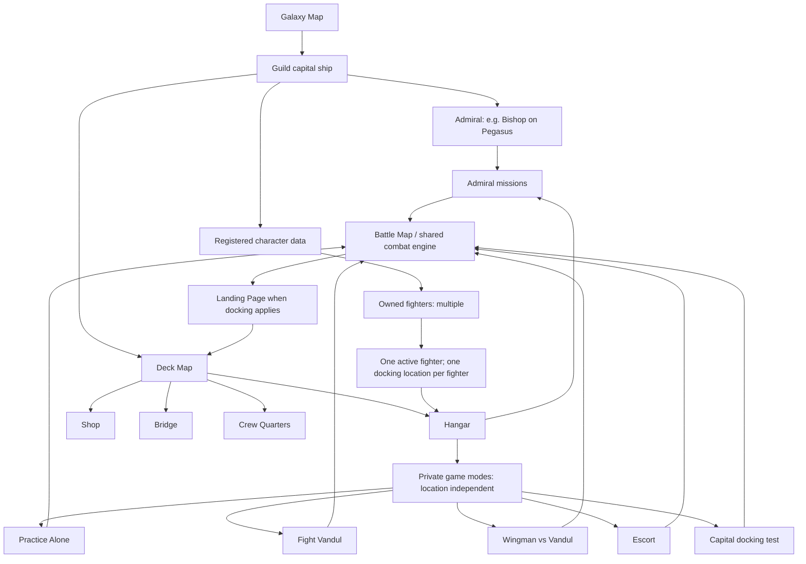

# Core Gameplay Structure — Instructions for Dot

Approved design direction: 24 November 2026.

## Objective
Prioritise core gameplay and links between existing systems. Pause story mission expansion so fighters, weapons and combat can be tested independently. Preserve existing working features.

## World and ownership hierarchy
- Galaxy Map is the root and central authority for world location.
- Guild capital ships are linked to the Galaxy Map. A capital ship belongs to the guild, not an individual player.
- Player data is linked to the player's assigned guild capital ship. Multiple players may belong to the same capital ship.
- Each character may own multiple fighters, but may access/control only one active fighter at a time. Each fighter has its own equipment and one docking location at a time (or is in flight). Character registration identifies the assigned guild and capital ship; only locally docked owned fighters are available to select and launch from that ship's Hangar. This is the agreed target architecture, not a claim that online accounts or membership already work.
- Preserve existing capital ship movement on the Galaxy Map; do not expand galaxy simulation now.

## Deck Map
Rename the existing Guild Vessel page (verify current implementation name) to **Deck Map**. This is the interactive top-down view of the assigned large ship, regardless of ship class. Nest these four sections beneath it:
- Hangar: fighter selection, equipment fitting, battle mission selection and launch.
- Shop: purchasing equipment and other existing shop functions.
- Bridge: existing bridge interactions.
- Crew Quarters: existing crew interactions.
Audit existing branches and navigation; keep related functions under their appropriate parent without removing working functionality.

## Battle Map
Support two configurations of the core battle system: fighter-only combat, and fighter combat with the capital ship present. Players pilot their fighters, not the capital ship. The capital ship is an interactive combat entity that can fire and be fired upon as appropriate. Select and launch battle missions from the Hangar. Admiral missions are associated with the assigned capital ship and its admiral; future galaxy encounter availability may additionally depend on world position. Private game modes are independent of Galaxy Map location. Defer new galaxy encounter logic.

## Landing Page
Rename the existing Capital Page to **Landing Page** (verify current implementation name). When a fighter lands in the capital ship hangar, transition to the Landing Page. Keep this separate from the Deck Map. Preserve existing docking, resupply and navigation functionality.

## Navigation and gameplay loop
Galaxy Map establishes guild ship location; Deck Map provides access to ship facilities; Hangar selects/prepares fighter and launches battle missions; Battle Map handles combat; docking returns the player to the Landing Page. Ensure the player can access the core gameplay loop without being blocked by starter story mission progression. Preserve the existing story for later development.

## Persistence
For now, focus persistence on player data and Galaxy Map state, including guild capital ship assignments and fighter ownership. Battle instances may remain temporary. Do not introduce a new persistent battle simulation in this phase.

## Future features — explicitly deferred
Persistent/shared online pirate encounters that spawn and despawn; selecting galaxy encounters to add missions; range-based launch availability while the capital ship travels; visible active battle markers (X) on the Galaxy Map; other players joining active battle instances; expanded story missions. These are future design concepts, not current implementation tasks.

## Handoff to Dot
Read this document before further gameplay development. Review existing architecture against the hierarchy, standardise naming and navigation, establish the required links, and prioritise testing all existing fighters and weapons. Report discrepancies and changes. Avoid unnecessary rebuilds or expanding deferred features.

## Expanded architecture — 24 November 2026

The character's ownership, active fighter selection, fighter docking location and guild/capital ship registration are separate relationships. Pegasus is the example: Admiral Bishop supplies Pegasus missions to eligible characters stationed there. Select and launch missions via the Hangar. The README identifies Pegasus and Bishop as narrative registry metadata; do not assume online registration or permission systems are already implemented.

### Hangar launch branches
- Admiral missions: capital ship/admiral-specific mission list; preserve existing official sortie and progression rules. Do not expand story missions now.
- Private single-player modes: independent of Galaxy Map location, using the selected fighter and its fitted equipment in isolated battle instances. Keep all existing modes for gameplay testing.

The repository README documents these private/test modes (verify current UI labels and routes before changing them):
- Practice Alone (Practice Mode): cones, no enemies or career effects.
- Fight Vandul (Solo Vanduul in discussion): solo enemy waves. Preserve existing credit/progression rules unless separately approved; do not assume every private mode is reward-free.
- Wingman vs Vandul (Wingman vs Vanduul in discussion): squad combat test, no career awards; destruction requires Hangar repair per README.
- Escort (Escort Mode): formation flight with freighter Orion, break away and rejoin; no enemies, rewards or saved damage.
- Capital (test): separate carrier docking/launch test with two Rift-4 wingmen; no saved credits or hull damage. Retain this existing test as well; do not remove or merge it without approval.

All modes should use the shared fighter simulation and loadout; preserve mode-specific rules. The README also documents a non-playable carrier observer preview, not a player game mode.

### Architecture tree

Source for existing features: [repository README](../README.md). This diagram is the agreed target navigation and data architecture, not an assertion that every relationship is currently implemented. Preserve existing functionality; audit actual code before renaming or relocating UI. No new multiplayer galaxy features in this phase.

## Player data architecture — agreed 24 November 2026

Player data is the persistent character record, separate from the shared Galaxy Map and guild capital ship records. The following is the target design, not a claim that every field is already implemented.

| Branch | Responsibility |
| --- | --- |
| Character identity | Stable character ID, profile and progression. |
| Guild registration | References to the character's assigned guild and capital ship. The capital ship belongs to the guild, not the character. |
| Fighter ownership | References to all fighters owned by the character; at most one active fighter at any time. |
| Individual fighter records | Fighter identity, hull condition, docking location or flight state, weapons, engine and fitted equipment. Each fighter can occupy only one location at a time. |
| Economy and inventory | Pilot credits, equipment purchases and owned equipment. Keep unfitted inventory separate from equipment mounted on individual fighters; avoid counting the same item twice. |

### Relationships and access
- The shared Galaxy Map determines the guild capital ship's world location.
- Character registration identifies the capital ship whose facilities and admiral missions are available; for example, Pegasus and Admiral Bishop.
- The Hangar allows selection and launch of eligible owned fighters docked on the assigned ship. Switching active fighters is a Hangar action, not a combat action.
- Private single-player/test modes remain independent of Galaxy Map position and use the selected fighter and its loadout. Preserve their existing mode-specific reward and damage rules.
- Keep fighter ownership separate from docking location and active selection. Do not assume fighters automatically transfer when a character changes assignment; transfer rules are not yet decided.

### Implementation status and scope
The repository README documents browser-local pilot credits, loadouts and settings, and describes the shared carrier location and vessel registry separately. Full online character identity, guild membership and persistent multi-fighter ownership are target features requiring verification and future implementation. Audit the existing implementation before changing persistence; do not discard existing saved data. This is a design handoff to Dot, not an instruction to build all future online systems now. Prioritise core gameplay linkage and testing; no expansion of the multiplayer Galaxy Map or story missions in this phase.
