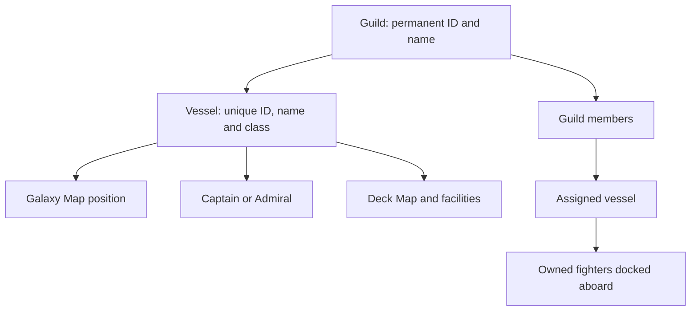

# Guild and Vessel Identity — approved implementation for Dot

24 November 2026. This is a scoped implementation instruction, not just a concept. The user authorises Dot to modify existing game code to implement this feature. It supersedes the earlier restriction against Galaxy Map changes only for this identity/linkage feature; all other deferred features remain deferred. Read [Core Gameplay Structure](CORE-GAMEPLAY-STRUCTURE.md) alongside this document.

## Design
The guild (or military organisation) is the persistent organisational identity. The vessel is the physical entity travelling on the Galaxy Map. The commander is assigned to a vessel, not its permanent identity. A guild may eventually own multiple vessels travelling independently.

## Logical records (adapt to existing implementation)
- Guild: stable guildId, display name, affiliation/type (military, merchant or independent), membership references.
- Vessel: stable vesselId for that physical hull, owning guildId, vessel name, class, commander reference, map position and crew assignments. Each vessel has one location at a time.
- Commander: independent identity and rank/title; may be reassigned without changing guild or vessel identity.
- Character: independent player identity, guild membership and assigned vessel reference; fighter ownership and docking location remain separate.

## Galaxy Map presentation
Each moving vessel marker is keyed internally by vesselId. Display guild name as the primary label, then vessel name and class, then commander name/title where space permits (or in the selected-vessel detail panel). Example: existing military guild/faction name (read actual data), Pegasus — Carrier, Admiral Bishop. Do not invent a military guild name if none is configured; use an explicit unassigned/unknown state until configured. Multiple vessels of one guild must remain separately selectable. Preserve existing movement, map layout and working navigation. Keep the existing admiral portrait treatment where applicable.

## Progression rules for later expansion
A guild may start with a small multi-crew ship and progress to larger permitted ships. Military capital ships and carriers are reserved for military organisations; civilian merchant and independent guilds may use permitted smaller multi-crew classes such as corvettes, frigates and cruisers, subject to future class rules. Upgrading equipment on the same hull preserves vesselId. Replacing a hull creates a new vesselId while guildId, membership and guild progression remain unchanged. Do not automatically relocate docked fighters or crew on replacement; transfer rules require separate design. Multiple players can belong to one vessel; do not implement online crew simulation in this task.

## Implementation order — authorised now
1. Audit existing registry, Galaxy Map movement, Pegasus/Bishop metadata, save format and navigation. Reuse working components and identifiers; avoid duplicate stores.
2. Introduce or adapt the minimal guild/vessel/commander records and relationships needed for the existing vessel. Preserve existing saves, movement and routes; use backward-compatible migration/defaults where needed. Do not claim online persistence if only local state is implemented.
3. Update the existing Galaxy Map marker and detail UI to present guild identity, ship name/class and commander. Resolve selection and facilities through vesselId, not display names.
4. Link existing character/Deck Map/Hangar references where supported; do not rebuild combat, inventory, authentication or mission systems. Document any unavailable relationships rather than fabricating them.
5. Test existing Pegasus movement, map selection, navigation and save reload. Test distinct vessel IDs under one guild using a fixture, and verify guild identity survives a simulated hull replacement without silently transferring fighters. Report files changed, test outcomes and limitations.

## Scope boundary
Implement the identity model, visible map labels and necessary existing-system links now. Do not build new ship models, guild creation UI, fleet purchasing, ship upgrade economy, multiplayer battles, online crew/NPC simulation, pirate encounters or additional story missions yet. Preserve all existing private game modes. No unnecessary rebuilds. This document authorises code changes specifically for this feature; Dot should implement and test it, not merely acknowledge the design.
